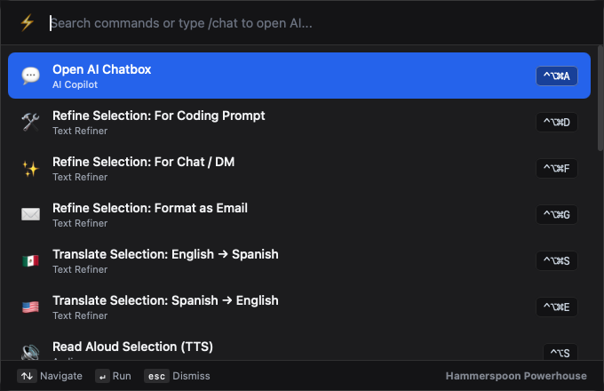
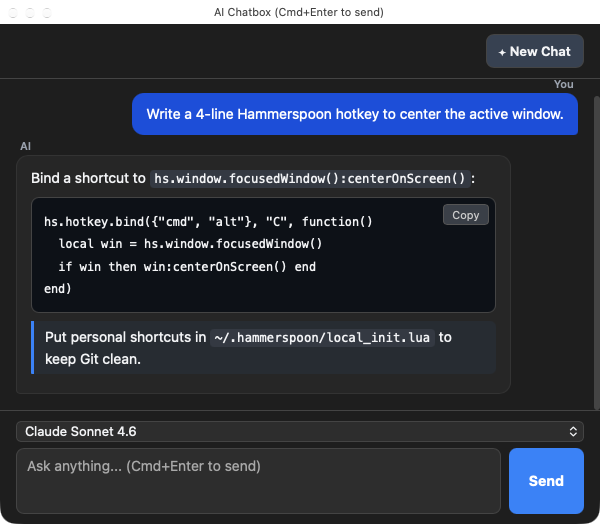
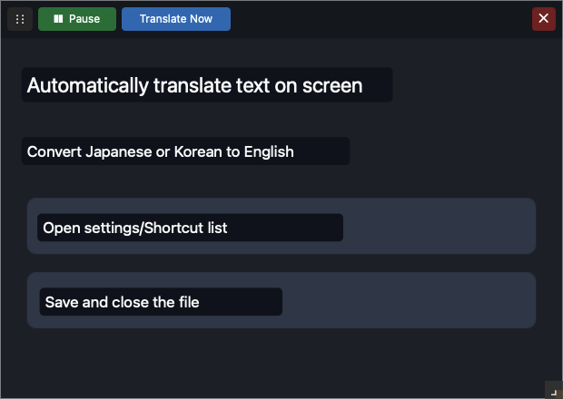
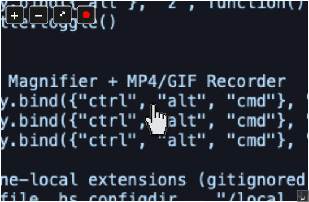
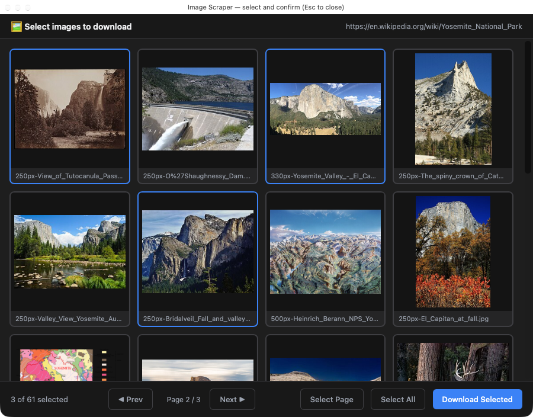
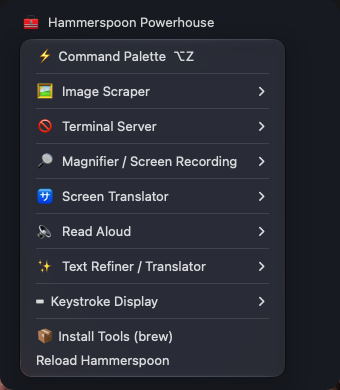

# ⚡ Hammerspoon Powerhouse

A modular, open-source macOS productivity kit and AI copilot built on [Hammerspoon](https://www.hammerspoon.org/). Every module is self-contained, toggleable via `.env`, and accessible from a unified Spotlight-style Command Palette (`⌥Z`) and Menubar Hub (`🧰`).

<p align="center">
  
</p>

---

## 📸 UI Showcase

<table>
  <tr>
    <td align="center" width="50%">
      <strong>💬 Floating AI Chatbox (<code>⌃⌥⌘A</code>)</strong><br />
      
    </td>
    <td align="center" width="50%">
      <strong>🈳 Live OCR Screen Translator (<code>⌃⌥⌘Y</code>)</strong><br />
      
    </td>
  </tr>
  <tr>
    <td align="center" width="50%">
      <strong>🔍 Mouse Magnifier &amp; Screen Recorder (<code>⌃⌥⌘M</code>)</strong><br />
      
    </td>
    <td align="center" width="50%">
      <strong>🖼️ Visual Image Scraper Gallery</strong><br />
      
    </td>
  </tr>
</table>

<p align="center">
  <strong>🧰 Unified Menubar Hub</strong><br />
  
</p>

---

## ✨ What's Included

### ⚡ 1. Unified Command Palette (`⌥Z`)
Spotlight-style keyboard launcher for every tool, AI transform, and shortcut:
- **Fuzzy Search**: Instantly filter and run any installed module or utility.
- **Quick AI Trigger**: Type `/chat <prompt>` to launch the floating AI Chatbox and submit directly.
- **Extensible**: Add your own commands via `command_palette.registerCommand(...)`.

### 🔍 2. Mouse Magnifier & Hardware Screen Recorder (`⌃⌥⌘M` / `⌃⌥⌘R`)
- Smooth cursor-following magnifier spanning from **Fit Whole Screen** (`⌃⌥⌘0`) up to **10x** zoom with click-pulse ring animations.
- Live hardware-accelerated recording (`ffmpeg` + Apple `h264_videotoolbox`) cropped directly to the magnifier frame, outputting **MP4** plus optional **GIF** (`gifski`) and **WebM** exports.

### 🔊 3. Multi-Engine Read Aloud & Cliffnotes Summarizer (`⌃⌥S` / `⌃⌥⇧S`)
- **`⌃⌥S` (Read Verbatim)** / **`⌃⌥⇧S` (Summarize to Spoken Cliffnotes & Read)**.
- **Multi-Engine Support** (switchable live from the menubar or `TTS_ENGINE` in `.env`):
  1. **Local Kokoro-82M** (offline sentence-chunked synthesis when `KOKORO_TTS_DIR` is configured)
  2. **OpenRouter Cloud TTS** (high-quality speech via `OPENROUTER_API_KEY`)
  3. **macOS `say`** (zero-config built-in offline fallback — works immediately out of the box)

### 🈳 4. Live Screen Translator & Apple Vision OCR (`⌃⌥⌘Y`)
- Draggable/resizable capture region with native Apple Vision OCR (`ocr_helper.swift`) and real-time translated text overlays drawn directly over matching bounding boxes.
- Dual backend: bundled local Node.js Google Translate server + optional Apple Translation CLI fallback.

### 💬 5. Floating AI Chatbox (`⌃⌥⌘A`)
- Streaming multi-model assistant via OpenRouter (Claude, Gemini, GPT, Grok, DeepSeek, or custom model IDs).
- Full Markdown rendering, syntax highlighting, one-click code copy buttons, and persistent conversation history.

### ✨ 6. LLM Text Refiner & Inline Translator (`⌃⌥⌘D/F/G/S/E`)
- Select text anywhere on macOS to clean raw speech-to-text dictation in place for **Coding Prompts** (`⌃⌥⌘D`), **Chat/DM** (`⌃⌥⌘F`), or **Email** (`⌃⌥⌘G`), or translate **EN ↔ ES** (`⌃⌥⌘S` / `⌃⌥⌘E`).
- Automatically routes to `XAI_API_KEY` (x.ai Grok), `OPENROUTER_API_KEY`, or `OPENAI_API_KEY`.

### 🖼️ 7. Visual Image Scraper
- Enter any webpage URL to extract images, preview and pick them in a paginated dark-mode WebView gallery, and batch-download selected files into `~/Downloads/scraped-images`.

### 🐚 8. Web Terminal Server & Mobile QR Pairing (`⌘⌥M` / `⌘⌥Q`)
- One-click web terminal (`ttyd` + mobile virtual keyboard wrapper `ttyd_mobile.html`).
- Automatic Tailscale HTTPS exposure + scannable on-screen QR code for instant iPhone/iPad terminal access.

### 🛠️ 9. Everyday Utilities & Unified Menubar Hub (`🧰`)
- **Window Picture-in-Picture** (`⌃⌥⌘T`): Pin any focused window as a live floating thumbnail.
- **Keystroke Visualizer** (`⌃⌥⌘K`): Clean on-screen HUD showing modifier chords & keys for demos and screen recordings.
- **Nightshade**: Click-through software redshift overlay that works even on Apple XDR / Reference Mode displays.
- **Official Spoons**: Bundled `ClipboardTool` (`⌘⌥V`) and `Caffeine` (`⌃⌥⌘C`).
- **Unified Menubar Hub (`🧰`)**: Consolidates all tools under one clean icon and supports `menubar_hub.registerTool(...)` for custom extensions.

---

## 🚀 Quickstart (2 Minutes)

### 1. Prerequisites
- macOS 13+ (Apple Silicon or Intel)
- [Hammerspoon](https://www.hammerspoon.org/) (`brew install --cask hammerspoon`)
- [Homebrew](https://brew.sh/) (for optional CLI tools like `ffmpeg`, `gifski`, `uv`, `ttyd`)

### 2. Clone & Run Installer
```bash
git clone https://github.com/64blit/hammerspoon-powerhouse.git ~/.hammerspoon
cd ~/.hammerspoon
./install.sh
```

`install.sh` is safe and idempotent:
- Creates `~/.hammerspoon/.env` from `.env.example` (never overwrites existing files)
- Creates `~/.hammerspoon/local_init.lua` from `local_init.example.lua` for custom hotkeys and extensions
- Optionally installs Homebrew dependencies (`ffmpeg`, `gifski`, `uv`, `ttyd`) and builds the OCR/translator helpers

### 3. Add Optional API Keys
Edit `~/.hammerspoon/.env`:
```env
OPENROUTER_API_KEY=sk-or-...
XAI_API_KEY=xai-...
```
> **Zero-key start:** Command Palette, Magnifier/Recorder, Visual Image Scraper, Window PiP, Keystroke Visualizer, Nightshade, Clipboard History, Caffeine, and Read Aloud (`macOS say`) all work immediately without any API keys.

### 4. Grant macOS Permissions & Launch
1. Open **Hammerspoon** and grant **Accessibility** and **Screen Recording** permissions in System Settings.
2. Press **`⌥Z`** (`Option + Z`) to open the Command Palette, or click **`🧰`** in your menubar!

---

## 🧩 Extending & Customizing

- **Toggle any module**: Set `ENABLE_<MODULE>=0` in `~/.hammerspoon/.env` (see [`.env.example`](.env.example)).
- **Custom hotkeys & modules**: Copy [`local_init.example.lua`](local_init.example.lua) to `local_init.lua` (ignored by Git) to add your own scripts, extra `command_palette.registerCommand(...)` entries, or `menubar_hub.registerTool(...)` submenus without merge conflicts on `git pull`.

---

## ⌨️ Default Keybindings

| Shortcut | Module | Action |
| :--- | :--- | :--- |
| `⌥Z` | **Command Palette** | Open Unified Command Palette |
| `⌃⌥⌘A` | **AI Chatbox** | Toggle floating multi-model LLM chatbox |
| `⌃⌥⌘M` | **Mouse Magnifier** | Toggle cursor magnifier |
| `⌃⌥⌘R` | **Magnifier Recorder** | Start / stop hardware MP4 + GIF screen recording |
| `⌃⌥⌘=` / `-` / `0` | **Mouse Magnifier** | Zoom in / zoom out / fit whole screen |
| `⌃⌥S` | **Read Aloud** | Speak selected text aloud (or stop) |
| `⌃⌥⇧S` | **Cliffnotes TTS** | Summarize selection via LLM and speak aloud |
| `⌃⌥⌘D` / `F` / `G` | **Text Refiner** | Refine dictation for Coding / Chat / Email |
| `⌃⌥⌘S` / `E` | **Text Refiner** | Translate selection EN→ES / ES→EN |
| `⌃⌥⌘Y` / `⇧Y` / `P` | **Screen Translator** | Toggle OCR overlay / translate now / pause |
| `⌘⌥M` / `U` / `Q` | **Web Terminal** | Toggle `ttyd` server / copy Tailscale link / show QR |
| `⌃⌥⌘T` | **Window PiP** | Pin focused window as Picture-in-Picture |
| `⌃⌥⌘K` | **Keystroke Visualizer** | Toggle on-screen keystroke HUD |
| `⌘⌥V` | **ClipboardTool** | Open clipboard history manager |
| `⌃⌥⌘C` | **Caffeine** | Toggle display sleep prevention |

---

## 📁 Repository Structure

```text
~/.hammerspoon/
├── init.lua                   # Master entrypoint & modular loader
├── env_loader.lua             # .env configuration loader
├── install.sh                 # Idempotent macOS setup script
├── .env.example               # Documented configuration & module toggle template
├── local_init.example.lua     # Template for custom hotkeys & extensions
├── command_palette.lua        # Unified Option+Z Spotlight palette
├── menubar_hub.lua            # Unified 🧰 menubar hub
├── image_scraper.lua          # Visual webpage image extractor & batch downloader
├── ai_chatbox.lua             # Streaming floating AI Chatbox (OpenRouter)
├── text_refiner.lua           # In-place dictation polisher & translator
├── text_to_speech.lua         # Multi-engine Read Aloud (Kokoro / OpenRouter / macOS say)
├── kokoro_speak.py            # Offline sentence-chunked Kokoro-82M synthesizer
├── openrouter_tts.py          # OpenRouter TTS & Cliffnotes LLM summarizer
├── mouse_magnifier.lua        # Magnifier + hardware MP4/GIF/WebM recorder
├── window_translator.lua      # Apple Vision OCR & real-time screen translation overlay
├── translator_helper/         # Swift Vision OCR helper & Node.js translation server
├── terminal_toggle.lua        # Web terminal controller & Tailscale QR overlay
├── terminal_server/           # ttyd launch scripts & mobile virtual keyboard UI
├── window_overlay.lua         # Floating Picture-in-Picture window mirror
├── keystroke_visualizer.lua   # On-screen keystroke HUD
├── nightshade.lua             # Software redshift screen tint overlay
├── spoons_setup.lua           # ClipboardTool & Caffeine configuration
├── install_tools.lua          # In-app one-click Homebrew dependency installer
├── assets/
│   ├── cursor_hand.png        # Custom magnifier pointer icon
│   └── screenshots/           # UI showcase screenshots
└── Spoons/                    # Bundled official Spoons
```

---

## 🤝 Contributing & License

Contributions, bug reports, and module PRs are welcome!

Released under the [MIT License](LICENSE).
